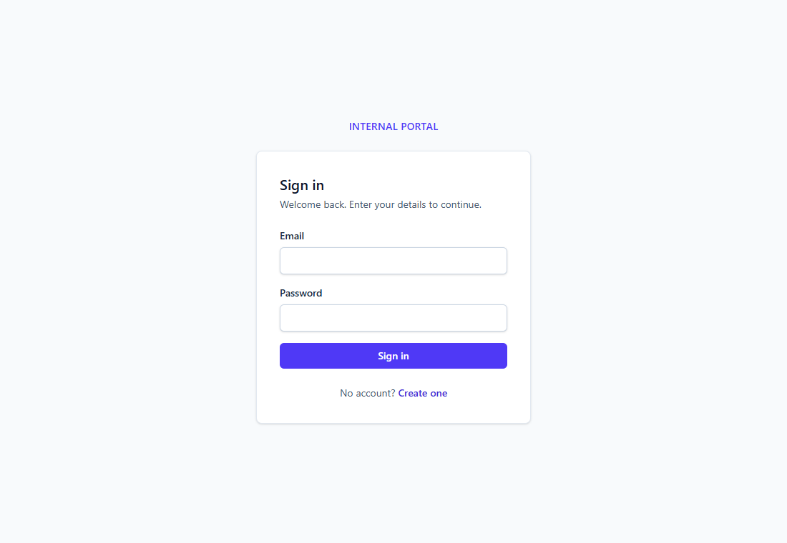
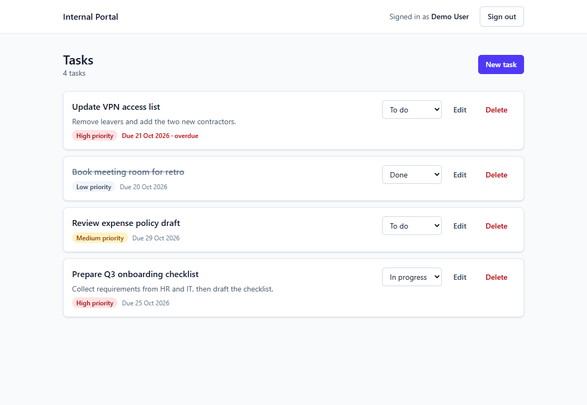
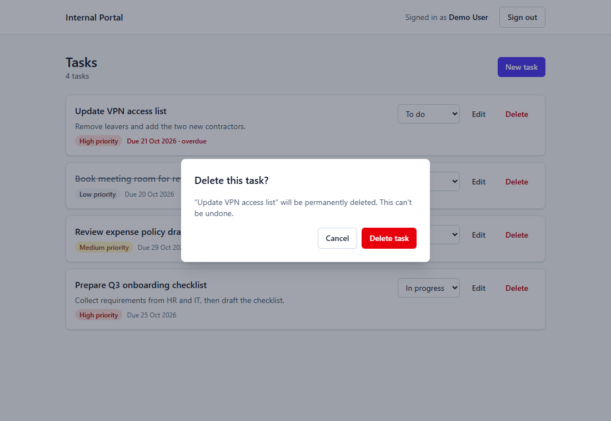

# Internal Portal

A small internal task tracker built as a take-home submission. Users sign up, sign in, and manage their own tasks: create, edit, change status inline, and delete with confirmation. The submission also includes the design and delivery plan for the next iteration (evidence upload plus admin review), in [`docs/Task_2.md`](docs/Task_2.md) and [`Task_2.pdf`](Task_2.pdf).

**Stack:** Next.js 15 (App Router, Route Handlers) · TypeScript (strict) · PostgreSQL 16 · Prisma 6 · Zod · Tailwind CSS 4 · Vitest · Playwright

| Sign in                                | Tasks                                | Delete confirmation                                   |
| -------------------------------------- | ------------------------------------ | ----------------------------------------------------- |
|  |  |  |

---

## 1. Setup

**Prerequisites:** Node 20+ and Docker. You can use an existing Postgres instead of Docker (see below).

```bash
cp .env.example .env
docker compose up -d          # Postgres 16 on :5432, plus a portal_test database for tests
npm install
npx prisma migrate dev        # apply committed migrations
npm run seed                  # demo data
npm run dev                   # http://localhost:3000
```

**Demo credentials** (from `npm run seed`):

| Role  | Email               | Password        |
| ----- | ------------------- | --------------- |
| User  | `demo@portal.test`  | `Password123!`  |
| Admin | `admin@portal.test` | `AdminPass123!` |

> **Port 5432 already in use?** Set `POSTGRES_PORT=5433` in `.env` and change the port in `DATABASE_URL` and `DATABASE_URL_TEST` to match. Compose reads `POSTGRES_PORT` for the host port.

### Using an existing Postgres instead of Docker

1. Create two databases, for example `portal` and `portal_test`. The user needs permission to `CREATE EXTENSION citext`, or a superuser must create it beforehand.
2. Point `DATABASE_URL` and `DATABASE_URL_TEST` in `.env` at them.
3. Run `npx prisma migrate deploy`, then `npm run seed`.

Hosted Postgres (Neon, Supabase, RDS) works the same way: use its connection string, keep `?sslmode=require`, and run `prisma migrate deploy` as a release step.

### Environment variables

`src/lib/env.ts` validates these with Zod when the server starts. A missing or invalid value stops the server with a clear error.

| Variable            | Purpose                                                      |
| ------------------- | ------------------------------------------------------------ |
| `DATABASE_URL`      | App database                                                 |
| `DATABASE_URL_TEST` | Separate database for integration tests (reset on every run) |
| `APP_URL`           | Public origin, used by the CSRF `Origin` check               |
| `SESSION_TTL_DAYS`  | Session lifetime (default 7)                                 |

## 2. Scripts and tests

| Script                                      | What it does                                                              |
| ------------------------------------------- | ------------------------------------------------------------------------- |
| `npm run dev` / `build` / `start`           | Next.js dev server / production build / production server                 |
| `npm run lint` · `typecheck` · `format`     | ESLint (zero warnings), `tsc --noEmit`, Prettier                          |
| `npm test`                                  | Unit tests plus integration tests (Vitest)                                |
| `npm run test:unit`                         | Unit tests only; no database needed                                       |
| `npm run test:integration`                  | Resets `DATABASE_URL_TEST` with `prisma migrate reset --force`, then runs |
| `npm run test:e2e`                          | Playwright: sign up → sign in → create/update/delete → sign out           |
| `npm run seed` · `db:migrate` · `db:deploy` | Seed demo data, create a migration, apply migrations                      |
| `npm run docs:pdf`                          | Rebuild `Task_2.pdf` from `docs/Task_2.md` (renders Mermaid first)        |

**Integration tests** never touch the dev database. The global setup refuses to run unless `DATABASE_URL_TEST` differs from `DATABASE_URL` and its database name contains `test`. Tests cover:

- password hashing and verification
- session create, validate, expire and revoke, plus the cascade on user delete
- auth (duplicate email in any case, identical errors for a wrong password and an unknown email)
- task ownership: user B cannot read, update, change the status of or delete user A's task, and gets the same 404 as for a missing task
- the restrict rule on deleting a user who still has tasks
- every Zod schema

**E2E:** `npx playwright install chromium` once, then `npm run test:e2e`. To reuse an installed browser, set `PLAYWRIGHT_CHANNEL=msedge` (or `chrome`). To test an already-running server, set `E2E_BASE_URL`.

**CI:** [`.github/workflows/ci.yml`](.github/workflows/ci.yml) runs lint, typecheck, format check, tests and build against a Postgres 16 service container.

## 3. Architecture

```
Browser ──▶ middleware.ts ──▶ Route Handler (app/api/**) ──▶ Service ──▶ Repository ──▶ Postgres
              │ optimistic cookie     │ route(): Origin check,      │ business rules,  │ Prisma only;
              │ check, redirects      │ Zod parse, requireUser(),   │ throws AppError  │ every task query
              │                       │ AppError → JSON envelope    │                  │ is owner-scoped
Server Components (pages) ─────────── requirePageUser() ──────────▶ Service (no HTTP hop)
```

- **`src/app`**: routes only. `(auth)` holds the sign-in and sign-up pages. `(portal)` is the session-guarded area, with a header and logout. `api/**` holds thin Route Handlers.
- **`src/server/services`**: business rules (ownership, 404 mapping, DTO shaping). Services never import Prisma.
- **`src/server/repositories`**: the only layer that touches Prisma. An ESLint `no-restricted-imports` rule enforces this.
- **`src/lib`**: cross-cutting code: `auth/` (sessions, password, guards), `validation/` (Zod schemas shared by client and server), `http.ts` (route wrapper and the `{ error: { code, message, details? } }` envelope), `security/` (Origin check, rate limiter) and `env.ts`.
- **`src/components`**: UI. Server components by default. Only interactive parts are client components: forms, `StatusSelect`, `DeleteTaskButton`/`ConfirmDialog` and `LogoutButton`.

**Auth is checked in three layers:**

1. `middleware.ts` makes an edge-safe check that the cookie exists, for fast redirects.
2. Every protected layout and page calls `requirePageUser()`, which checks the session in the database.
3. Every API handler calls `requireUser()` (401). Task queries always include `createdById = currentUser`, so a task owned by someone else is indistinguishable from a missing one (404).

## 4. Key decisions and trade-offs

- **PostgreSQL over SQLite or Mongo:** relational integrity (FKs with `CASCADE` for sessions and `RESTRICT` for task owners), native enums, `citext` for case-insensitive unique emails, `timestamptz`, and indexes chosen for Part 2 (`assigneeId`, `status`, `(assigneeId, status)`). Docker gives the same database locally as in production. In production I'd use a managed Postgres (Neon or Supabase for speed, RDS for AWS shops) and run `prisma migrate deploy` in the release step. Migrations are committed; `db push` is never used.
- **DB sessions over stateless JWT:**
  - Sessions can be revoked on logout or compromise. A JWT stays valid until it expires unless you build a denylist, which brings back the database lookup anyway.
  - It's simpler to get right: no signing-key rotation and no confusion between claims and state.
  - The cookie holds 32 random bytes. Postgres stores only the SHA-256 hash, so a database leak exposes no usable tokens.
  - Cost: one indexed lookup per request, deduplicated per render with React `cache()`.
- **Custom auth over Auth.js:** the brief asks for email and password only. About 150 lines of explicit code show the security decisions (hashing, cookie flags, enumeration, rate limits, revocation) more clearly than library configuration. With OAuth/SSO or MFA on the roadmap, I'd adopt Auth.js or a hosted IdP.
- **Password hashing:** bcrypt at cost 12 via `bcryptjs`, a pure-JS implementation with the same `$2b$` format and no native build step for Windows or CI. Passwords over 72 bytes are rejected rather than silently truncated. Unknown emails still run a bcrypt compare, so response timing doesn't reveal which accounts exist.
- **Route Handlers over Server Actions:** the brief asks for an API, and a REST surface is testable with curl, reusable by other clients, and gives explicit status codes (400/401/404/409/429). Pages still read data directly through services on first load, with no HTTP hop. Server Actions would be a good fit for the forms later.
- **Status values:** `TODO`, `IN_PROGRESS` and `DONE` are a native Postgres enum. Part 2 adds `PENDING_REVIEW`, `REJECTED` and `CANCELLED` with `ALTER TYPE … ADD VALUE`, which needs no table rewrite. The client mirrors the enum in `lib/validation/task.ts` so the browser never imports `@prisma/client`, and a test guards against drift.
- **Fields added early for Part 2:** `role` (USER/ADMIN), with an admin user seeded. `assigneeId` is nullable and defaults to the creator. Ownership scope lives in one repository function (`ownedBy`), so widening visibility to the assignee and admins later is a single change.
- **CSRF:** cookies are `SameSite=Lax` and `httpOnly`, and `Secure` with the `__Host-` prefix in production. On top of that, every mutating request must send an `Origin` matching `APP_URL` or the request host, or a non-cross-site `Sec-Fetch-Site` header. Requests without either header come from non-browser clients, which can't carry a victim's cookies.
- **Rate limiting:** in-memory fixed windows. Login allows 20 attempts per IP and 10 per email per 15 minutes; signup allows 5 per IP per hour. The response is 429 with `Retry-After`. This is fine for one process, but it resets on deploy and isn't shared between instances, so production would use Redis/Upstash or the edge platform's limiter. `X-Forwarded-For` is only trustworthy behind a proxy you control.
- **Signup enumeration:** signup returns 409 when an email already exists. That's a deliberate UX trade-off. Fully closing the gap needs email verification ("check your inbox" in both cases), which is listed under next steps.
- **Due date:** stored as a Postgres `date`, because it's a calendar day, not an instant. All other timestamps are `timestamptz`.
- **Optimistic status change:** `useOptimistic` in a transition. If the PATCH fails, the transition ends without a refresh and React restores the server value automatically.
- **Correct 404s with streaming:** `loading.tsx` sits in a `(list)` route group so it wraps only the list. A Suspense boundary above `/tasks/[id]/edit` would stream a 200 before `notFound()` runs.

## 5. What I'd do next

- Pagination (cursor-based) and the Part 2 filters, using the composite index
- Email verification and password reset (single-use, hashed, short-lived tokens), then closing signup enumeration
- An audit log for task changes and auth events, and session management ("sign out other devices")
- A shared rate-limit store (Redis), plus account lockout with notification
- Deployment: Vercel or a container on Fly/Render with managed Postgres, `prisma migrate deploy` in the release phase, and a strict Content-Security-Policy with nonces
- Observability: structured logs with request IDs, Sentry, and metrics on auth failures and latency
- A scheduled cleanup of expired sessions (`deleteExpiredSessions` already exists), and a test of the HTTP layer against a running server in CI
