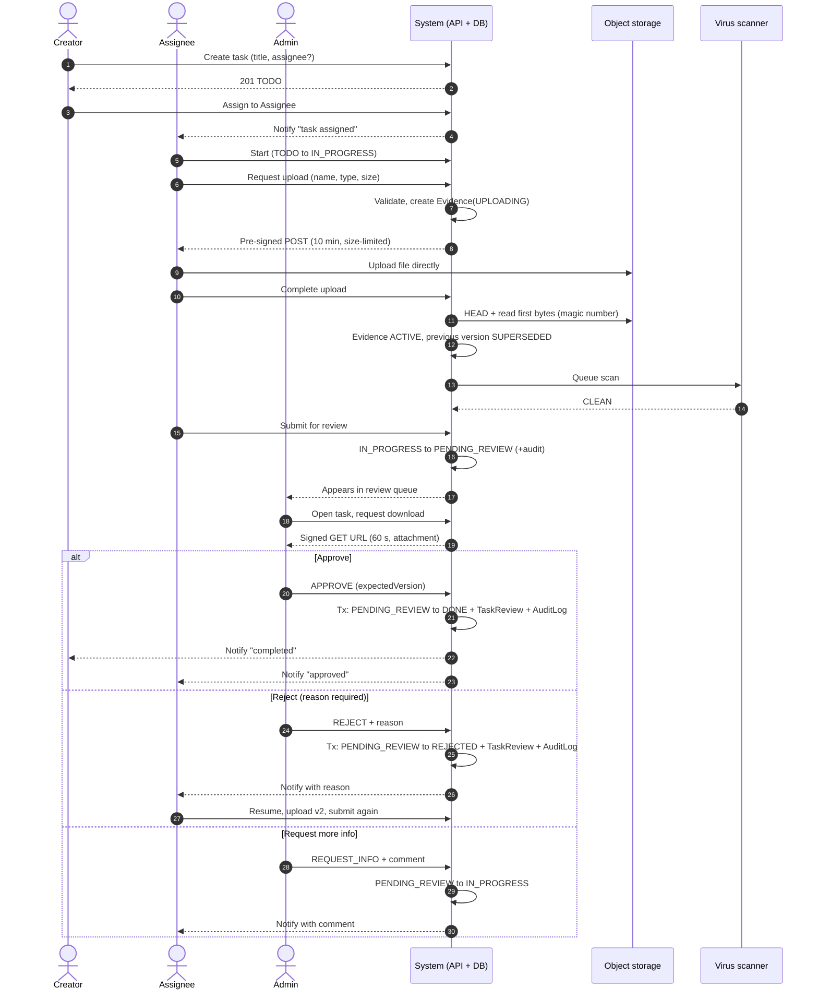
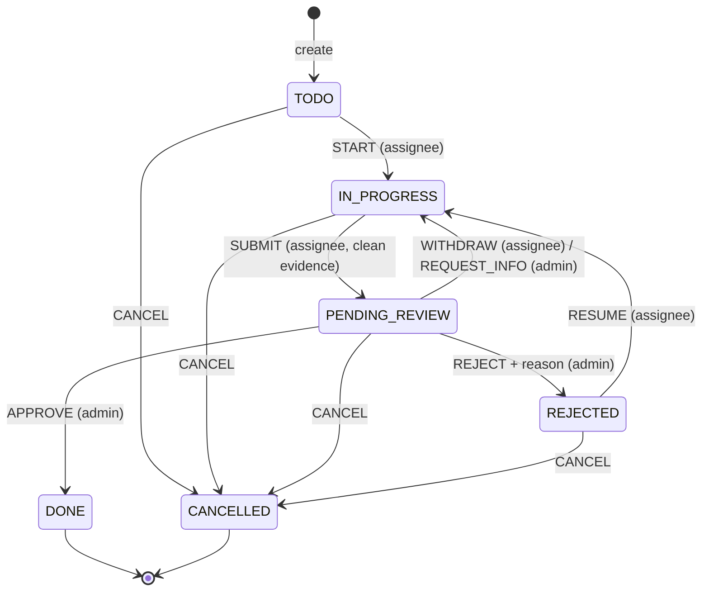
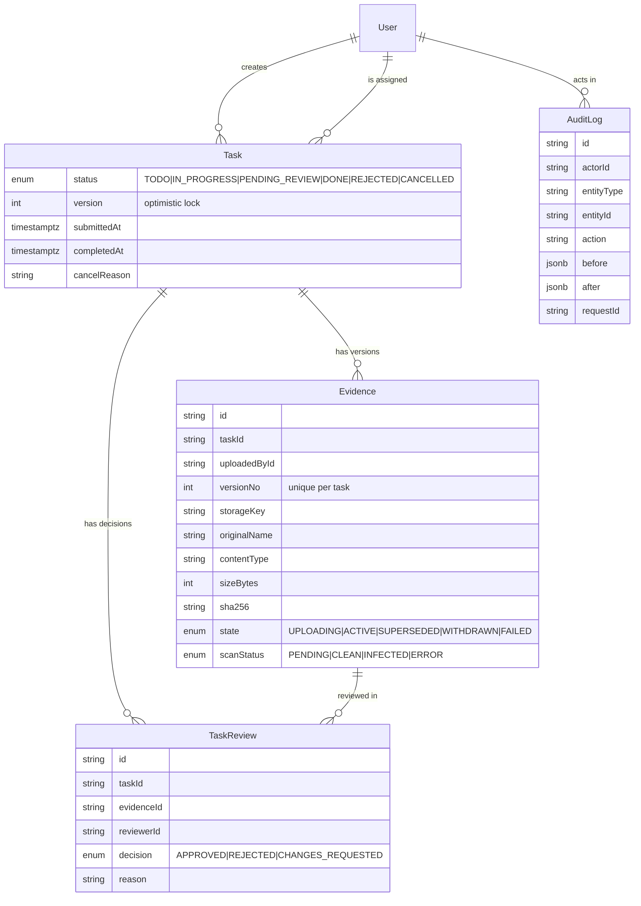
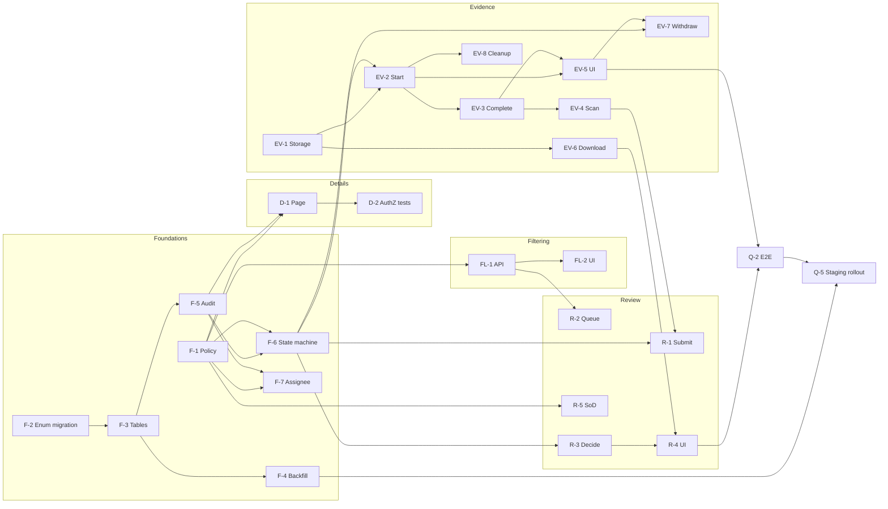
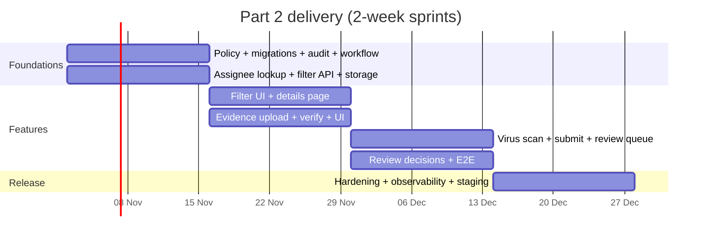

# Overview

**New requirements**

1. Filter tasks by status and by assignee.
2. A dedicated task details screen.
3. The assigned user uploads an evidence document.
4. An admin reviews the evidence and approves completion.

**Design principles**

- **The server owns the workflow.** Status changes go through one table-driven state machine in the service layer. Clients request an _action_ (`SUBMIT`, `APPROVE`, …), never a raw status.
- **One authorization policy.** A pure `can(actor, action, task)` module decides every permission. Pages, API handlers and the transition service all call it, and it is unit-tested exhaustively.
- **Files never pass through the app server.** Browsers upload straight to S3-compatible object storage with short-lived pre-signed URLs. Postgres stores metadata, versions and scan results.
- **Everything is auditable.** Each transition, upload and review decision writes an `AuditLog` row in the same database transaction as the change.
- **It builds on Part 1.** `role`, `assigneeId` and the `(assigneeId, status)` index already exist. Ownership scoping lives in one repository function, which Part 2 widens.

# A. Process flow map

## A.1 Happy path

1. **Created.** A user (the _creator_) creates a task. It starts in `TODO`, and an assignee is optional at creation.
2. **Assigned.** The creator or an admin picks an assignee from the user lookup. The assignee gets a notification (stretch goal).
3. **In progress.** The assignee starts work: `TODO → IN_PROGRESS`.
4. **Evidence uploaded.** The assignee asks for an upload slot. The API validates the declared type and size, creates an `Evidence` row (`UPLOADING`) and returns a pre-signed POST. The browser uploads directly to object storage. The client then calls _complete_. The server checks the stored object's size, magic bytes and checksum, marks the evidence `ACTIVE`, and queues a virus scan.
5. **Submitted for review.** Once the latest evidence is `CLEAN`, the assignee submits: `IN_PROGRESS → PENDING_REVIEW`. The task appears in the admin review queue.
6. **Admin review.** An admin who is not the assignee opens the task, downloads the evidence through a short-lived signed URL, and records a decision.
7. **Approved → completed.** Approval moves `PENDING_REVIEW → DONE` and writes a `TaskReview` and an `AuditLog` row in one transaction. The creator and assignee are notified.

## A.2 Flowchart with alternative paths

**Alternative paths**

| Scenario | Trigger and actor | Behaviour | Resulting status |
| --- | --- | --- | --- |
| **Admin rejects** | Admin; a reason is required (≥ 10 characters) | A `TaskReview(REJECTED, reason)` row is written. The evidence stays as history. The assignee sees the reason on the details page. | `REJECTED`, then `IN_PROGRESS` when the assignee resumes (an upload resumes automatically) |
| **Resubmit after rejection** | Assignee | Uploads a new version (`v n+1`; the earlier one becomes `SUPERSEDED`), then submits again | `PENDING_REVIEW` |
| **Admin requests more info** | Admin; a comment is required | `TaskReview(CHANGES_REQUESTED)`. Unlike a rejection, the current evidence stays `ACTIVE`. The assignee can answer by adding a note and resubmitting without a new file. | `IN_PROGRESS` |
| **Reassigned mid-work** | Creator or admin, while `TODO`, `IN_PROGRESS` or `REJECTED` | `assigneeId` changes. Existing evidence is kept but flagged as uploaded by the previous assignee, and the new assignee must upload their own before submitting. Both users are notified. Blocked while `PENDING_REVIEW`; the task must be withdrawn first. | Unchanged |
| **Upload fails or file invalid** | System | The declared type or size is rejected up front with 400. If the stored object doesn't match on _complete_ (wrong magic bytes, size or checksum), the object is deleted, the evidence is marked `FAILED` and the user gets 422. Network failures can be retried. Unfinished `UPLOADING` rows older than 24 hours are removed by a cleanup job and an S3 lifecycle rule. | Unchanged |
| **Withdraw or replace evidence before review** | Assignee | While `IN_PROGRESS`, uploading again replaces the active version. While `PENDING_REVIEW`, _Withdraw_ returns the task to `IN_PROGRESS`, but only if no admin has claimed or decided it. | `IN_PROGRESS` |
| **Task cancelled** | Creator or admin; a reason is required | Allowed from any non-terminal state. Evidence is retained under the retention policy, and an open review is closed. | `CANCELLED` (terminal) |
| **Unassigned task** | — | `assigneeId = null`. The task can't be started, so the "Start" action is hidden and the API returns 409. It appears under the _Unassigned_ filter. | `TODO` |
| **Virus scan finds malware** | System | The object moves to a quarantine prefix and evidence is set to `scanStatus = INFECTED`. Submit stays blocked, and the security channel is alerted. | Unchanged |
| **Two admins review at once** | Admins | The first commit wins through a version check. The second gets 409 and a refreshed view. | Whatever the first decision set |

## A.3 Swimlane view by actor

## A.4 Status state machine

**Transitions and permissions** (enforced in `task-workflow.service.ts` and the `can()` policy)

| # | From → To | Action | Who may perform it | Guards and side effects |
| --- | --- | --- | --- | --- |
| 1 | — → `TODO` | `CREATE` | Any authenticated user | The creator is recorded. The assignee is optional. |
| 2 | `TODO` → `IN_PROGRESS` | `START` | Current assignee | `assigneeId` must be set |
| 3 | `IN_PROGRESS` → `PENDING_REVIEW` | `SUBMIT` | Current assignee | The latest evidence is `ACTIVE`, `CLEAN` and was uploaded by the current assignee. Sets `submittedAt`. |
| 4 | `PENDING_REVIEW` → `IN_PROGRESS` | `WITHDRAW` | Current assignee | No review decision recorded yet |
| 5 | `PENDING_REVIEW` → `IN_PROGRESS` | `REQUEST_INFO` | Admin | Comment required. Writes `TaskReview(CHANGES_REQUESTED)`. |
| 6 | `PENDING_REVIEW` → `DONE` | `APPROVE` | Admin who is **not** the assignee | `expectedVersion` matches. Sets `completedAt`. Writes `TaskReview(APPROVED)`. |
| 7 | `PENDING_REVIEW` → `REJECTED` | `REJECT` | Admin who is **not** the assignee | Reason ≥ 10 characters. Writes `TaskReview(REJECTED)`. |
| 8 | `REJECTED` → `IN_PROGRESS` | `RESUME` | Current assignee | Implicit when a new version is uploaded |
| 9 | any non-terminal → `CANCELLED` | `CANCEL` | Creator or admin | Reason required. Terminal. |
| — | (field change) | `REASSIGN` | Creator or admin | Status ∈ {`TODO`, `IN_PROGRESS`, `REJECTED`}; the new assignee is an active user |

`DONE` and `CANCELLED` are terminal. Re-opening a task is out of scope; if it's needed later, it becomes an admin-only `REOPEN` transition. The Part 1 inline status select keeps working, but it only offers the actions valid for the viewer, so a user can no longer jump straight to `DONE`.

**Who can see a task:** its creator, its current assignee, and any admin. Everyone else gets **404** (as in Part 1). A user who _can_ see a task but attempts an action they aren't allowed gets **403**, and a disallowed transition gets **409**.

## A.5 Data model changes

**Migration strategy (live Postgres)**

1. **Migration 1, enum values only:** `ALTER TYPE "TaskStatus" ADD VALUE 'PENDING_REVIEW'` (and `REJECTED`, `CANCELLED`). New enum values can't be used in the same transaction that adds them, so they go in their own migration. Adding values doesn't rewrite the table.
2. **Migration 2, new tables and columns:** `evidence`, `task_reviews` and `audit_logs`; `tasks.version INT NOT NULL DEFAULT 0`, `submittedAt`, `completedAt` and `cancelReason`. All are additive and nullable or defaulted, so there are no long locks. New indexes are created `CONCURRENTLY` in a hand-edited migration.
3. **Migration 3, data backfill:** existing tasks keep their status. Existing `DONE` tasks are grandfathered as completed without review, recorded with an `AuditLog(action = 'MIGRATED_DONE')`. Any `assigneeId IS NULL` stays unassigned. The backfill runs in batches and is idempotent.
4. **Expand, then contract:** the new code ships tolerant of both shapes. Old status-only endpoints are removed one release later.

## A.6 API surface (additions)

| Method and path | Purpose |
| --- | --- |
| `GET /api/tasks?status=…&assignee=me\|unassigned\|<id>&cursor=` | Filtered, cursor-paginated list (Zod-validated query) |
| `GET /api/users?query=` | Assignable-user lookup: `id` and `name` only, min 2 characters, rate-limited |
| `GET /api/tasks/:id` | Details, including evidence versions, reviews and the activity timeline |
| `PATCH /api/tasks/:id/assignee` | Reassign (creator or admin) |
| `POST /api/tasks/:id/transitions` | `{ action, reason?, expectedVersion }` passed to the state machine |
| `POST /api/tasks/:id/evidence` | Starts an upload; returns `{ evidenceId, url, fields }` (a pre-signed POST) |
| `POST /api/tasks/:id/evidence/:eid/complete` | Verifies the stored object, activates the version, queues the scan |
| `GET /api/tasks/:id/evidence/:eid/download` | 302 to a signed GET (60 s, `Content-Disposition: attachment`) |
| `GET /api/admin/reviews?cursor=` | Review queue (`PENDING_REVIEW`, oldest first) |
| `POST /api/admin/reviews/:taskId` | `{ decision, reason, expectedVersion }` |

# B. Sprint implementation plan

## B.1 Assumptions

- **Cadence:** 2-week sprints. The team is 3 developers (2 full-stack, 1 backend-leaning) plus 1 QA, with me as tech lead (reviews, architecture, about 50% hands-on).
- **Velocity:** about 30 story points per sprint for the team, based on Part 1 throughput with a 20% buffer for reviews and meetings. Points use a Fibonacci scale; 1 point is roughly half a dev-day.
- **Evidence rules:**
  - One evidence file per submission; a new upload creates a new version, and every version is kept (history is never deleted).
  - Maximum 10 MB.
  - Allowed: PDF, PNG, JPG and DOCX. The declared MIME type and the magic bytes must agree.
- **Storage:** S3-compatible object storage (AWS S3 in production, MinIO in `docker-compose` locally) with pre-signed URLs. The bucket is private, encrypted (SSE-S3 or KMS), and blocks public access. Metadata lives in Postgres.
- **Admins:** seeded, or promoted through a database script or admin CLI. Role-management UI is out of scope.
- **Virus scanning:** ClamAV as a container worker, triggered from a job queue (a Postgres-backed queue such as `pg-boss`, avoiding a new infrastructure dependency). It can be swapped for a managed scanner.
- **Notifications:** a stretch goal. Delivery is in-app first, with email through a transactional provider using an outbox table.

## B.2 Epics and stories

Estimates are in story points. **AC** are acceptance criteria in Given / When / Then form.

### Epic 1: Foundations (RBAC, schema, workflow core)

| ID | Title | Description | Est | Depends on | Acceptance criteria |
| --- | --- | --- | --- | --- | --- |
| F-1 | Authorization policy module | Pure `can(actor, action, task)` covering view, edit, assign, start, upload, submit, withdraw, review and cancel, plus `requireRole('ADMIN')`. Includes table-driven unit tests for every role × status × action combination. | 3 | — | **Given** a user who is neither creator, assignee nor admin **When** they request `GET /api/tasks/:id` **Then** they get 404. **Given** an assignee **When** `can(assignee, 'REVIEW', task)` is called **Then** it returns false. |
| F-2 | Schema migration: enum values | A dedicated migration adding `PENDING_REVIEW`, `REJECTED` and `CANCELLED` with `ALTER TYPE … ADD VALUE` | 2 | — | **Given** a database at the Part 1 schema **When** `prisma migrate deploy` runs **Then** the enum has 6 values and no table is rewritten (checked against a production-sized snapshot). |
| F-3 | Schema migration: tables and columns | `Evidence`, `TaskReview` and `AuditLog`; `Task.version`, `submittedAt`, `completedAt` and `cancelReason`; indexes, with concurrent creation where needed | 5 | F-2 | **Given** the migrated database **When** I insert evidence with a duplicate `(taskId, versionNo)` **Then** the unique constraint rejects it. **And** deleting a task with evidence is restricted. |
| F-4 | Data backfill | Idempotent batch script: grandfather `DONE` tasks with an audit entry and verify counts. Rehearsed on staging. | 3 | F-3 | **Given** existing `DONE` tasks **When** the backfill runs twice **Then** each has exactly one `MIGRATED_DONE` audit row and the status is unchanged. |
| F-5 | Audit log service | `audit.record(tx, {...})`, called inside the same transaction as each change; captures the request ID and actor | 3 | F-3 | **Given** any state transition **When** the transaction commits **Then** exactly one matching `AuditLog` row exists. **When** it rolls back **Then** none does. |
| F-6 | Workflow state machine | A table-driven transition service implementing the A.4 table, with guard functions and an optimistic `version` check. It replaces free-form status updates. | 5 | F-1, F-5 | **Given** a task in `TODO` **When** `SUBMIT` is requested **Then** the API returns 409 `INVALID_TRANSITION` and the status is unchanged. |
| F-7 | Assignee lookup and reassignment | `GET /api/users?query=` (id and name only, rate-limited), an accessible combobox, and `PATCH /assignee` with the A.2 rules | 5 | F-1, F-5 | **Given** a task in `PENDING_REVIEW` **When** the creator reassigns it **Then** they get 409 with "withdraw first". **Given** a 1-character query **Then** they get 400. |

### Epic 2: Filtering

| ID | Title | Description | Est | Depends on | Acceptance criteria |
| --- | --- | --- | --- | --- | --- |
| FL-1 | Filtered list API | Zod-validated `status` (multi), `assignee` (`me`, `unassigned` or an id) and a cursor; visibility scope applied first; uses the `(assigneeId, status)` index | 3 | F-1 | **Given** 10k seeded tasks **When** I filter by `assignee=me&status=IN_PROGRESS` **Then** `EXPLAIN` shows an index scan on `tasks_assigneeId_status_idx` and p95 is under 50 ms. |
| FL-2 | URL-synced filter UI | Filter bar driving `searchParams`, server-rendered results, shareable URLs, a "Clear filters" action and empty states | 3 | FL-1 | **Given** I apply status=Done **When** I reload or share the URL **Then** the same filtered list renders. **And** the controls are keyboard-operable and labelled. |

### Epic 3: Task details

| ID | Title | Description | Est | Depends on | Acceptance criteria |
| --- | --- | --- | --- | --- | --- |
| D-1 | `/tasks/[id]` details page | Server component showing fields, assignee, status, available actions (from `can()`), evidence versions, review history and the activity timeline from the audit log. Includes `loading`, `not-found` and `error` states. | 5 | F-1, F-5 | **Given** I'm the assignee **When** I open the page **Then** I see Upload and Submit but not Approve. **Given** I'm unrelated **Then** I get the 404 page with a real 404 status. |
| D-2 | Details authorization tests | Integration tests for creator, assignee, admin and outsider across every endpoint under `/api/tasks/:id/**` | 2 | D-1 | **Given** the role matrix **When** the suite runs **Then** every cell asserts the expected 200, 403 or 404. |

### Epic 4: Evidence upload

| ID | Title | Description | Est | Depends on | Acceptance criteria |
| --- | --- | --- | --- | --- | --- |
| EV-1 | Storage abstraction | An `ObjectStorage` interface (`presignPost`, `head`, `readRange`, `move`, `presignGet`, `delete`), an S3 implementation, MinIO in compose, and an in-memory fake for tests | 3 | — | **Given** the fake adapter **When** the service tests run **Then** no network calls are made. **And** the S3 adapter passes a contract test against MinIO in CI. |
| EV-2 | Start upload | `POST /evidence`: only the assignee, only in `IN_PROGRESS` or `REJECTED`; validates the declared type and size (≤ 10 MB); creates `Evidence(UPLOADING)`; returns a pre-signed POST with `content-length-range` and a fixed `Content-Type`, expiring in 10 minutes. Keys are random (`evidence/{taskId}/{uuid}`) and never use the original filename. | 5 | EV-1, F-6 | **Given** a 12 MB file **When** an upload starts **Then** the API returns 400 `FILE_TOO_LARGE`. **Given** the creator, who isn't the assignee, **Then** they get 403. **Given** status `PENDING_REVIEW` **Then** they get 409. |
| EV-3 | Complete and verify upload | `HEAD` checks the size, magic bytes are read to verify the type, and the SHA-256 is recorded. The version is activated and the previous one superseded in a transaction; on mismatch the evidence is marked `FAILED` and the object deleted. | 3 | EV-2 | **Given** a `.pdf` whose bytes are a PNG **When** the upload completes **Then** the API returns 422 and evidence is `FAILED`. **Given** a valid file **Then** `versionNo` increments and the earlier version is `SUPERSEDED`. |
| EV-4 | Virus-scan hook | A job queue plus a ClamAV worker. `scanStatus` moves `PENDING → CLEAN/INFECTED/ERROR`. Infected files are moved to `quarantine/` and alerted on. Submit is blocked until `CLEAN`. | 5 | EV-3 | **Given** the EICAR test file **When** it's scanned **Then** status is `INFECTED`, the object is quarantined and submit returns 409. **Given** a scanner outage **Then** status stays `PENDING` and the job retries with backoff. |
| EV-5 | Upload UI | Drag-and-drop or a file picker, client-side type and size check, a progress bar, retry, scan-status badge and version list. Accessible announcements via `aria-live`. | 5 | EV-2, EV-3 | **Given** a network drop mid-upload **When** I click Retry **Then** a fresh pre-signed URL is used and the upload succeeds. **And** progress is announced to screen readers. |
| EV-6 | Secure download | Authorized `GET …/download` responds with a 302 to a 60-second signed URL with `attachment` disposition. Infected or failed files are never served. | 2 | EV-1, F-1 | **Given** an outsider **When** they request a download **Then** they get 404. **Given** an admin **Then** the signed URL expires after 60 s. |
| EV-7 | Withdraw and replace before review | `WITHDRAW` transition and a "Replace file" UI flow | 2 | F-6, EV-5 | **Given** `PENDING_REVIEW` with no decision **When** the assignee withdraws **Then** status is `IN_PROGRESS` and the evidence is still listed. |
| EV-8 | Orphan cleanup | Scheduled job removes `UPLOADING` rows older than 24 hours, plus an S3 lifecycle rule for unreferenced keys | 2 | EV-2 | **Given** an abandoned upload older than 24 hours **When** the job runs **Then** the row is `FAILED` and the object is gone. |

### Epic 5: Admin review

| ID | Title | Description | Est | Depends on | Acceptance criteria |
| --- | --- | --- | --- | --- | --- |
| R-1 | Submit for review | `SUBMIT` transition with an evidence guard and a UI button with confirmation | 2 | F-6, EV-4 | **Given** the latest evidence is `PENDING` scan **When** the assignee submits **Then** they get 409 "Evidence is still being scanned". |
| R-2 | Review queue | `/admin/reviews`: admin-only; oldest first; shows age and assignee; paginated | 3 | F-1, FL-1 | **Given** a non-admin **When** they open `/admin/reviews` **Then** they get 404. **Given** 3 pending tasks **Then** they're listed oldest first. |
| R-3 | Review decision endpoint | Approve, reject or request info inside one DB transaction: `UPDATE … WHERE id=$1 AND status='PENDING_REVIEW' AND version=$2`, then insert `TaskReview` and `AuditLog` | 5 | F-5, F-6 | **Given** two admins approve and reject at the same time **When** both submit **Then** exactly one succeeds and the other gets 409 `STALE_VERSION`, with one `TaskReview` row. **Given** a rejection without a reason **Then** they get 400. |
| R-4 | Review UI | Evidence preview (images inline, others downloaded), a decision form with mandatory reason, and a conflict banner with refresh | 3 | R-3, EV-6 | **Given** I choose Reject **When** the reason is empty **Then** submit stays disabled and an inline error is announced. |
| R-5 | Segregation of duties | Admins can't review tasks they're assigned to; enforced in `can()` | 1 | F-1 | **Given** an admin who is the assignee **When** they approve **Then** they get 403. |

### Epic 6: Notifications, audit, quality and release

| ID | Title | Description | Est | Depends on | Acceptance criteria |
| --- | --- | --- | --- | --- | --- |
| N-1 | Notifications _(stretch)_ | An outbox table written in the transition transaction. A worker sends in-app and email messages for assigned, submitted, rejected and approved. | 5 | F-5 | **Given** a rejection **When** the transaction commits **Then** exactly one outbox message is delivered to the assignee, even if the worker restarts. |
| Q-1 | Activity timeline | A details-page timeline rendered from the `AuditLog` (who, what, when) | 2 | D-1, F-5 | **Given** a rejected-then-approved task **Then** the timeline shows each step with actor and time. |
| Q-2 | End-to-end tests | Playwright: happy path, rejection loop, invalid file, concurrent review (two browser contexts), outsider access | 5 | R-4, EV-5 | **Given** CI with Postgres, MinIO and a ClamAV stub **When** the e2e job runs **Then** every scenario passes. |
| Q-3 | Observability | Structured logs with request ID; metrics for upload failures, scan latency, review lead time and 409 rate; alerts on scan errors and infected files | 3 | EV-4, R-3 | **Given** an infected upload **Then** an alert fires within 5 minutes. **And** dashboards show the review backlog by age. |
| Q-4 | Documentation | README, API reference, a runbook for migration rollback and scanner outage, and ADRs for storage and the state machine | 2 | — | **Given** a new developer **When** they follow the README **Then** they run the full flow locally with MinIO in under 30 minutes. |
| Q-5 | Staging rollout | Migration rehearsal on a staging copy of production data, a feature flag for the review workflow, and a staged rollout | 2 | F-4, Q-2 | **Given** staging **When** migrations run **Then** there's no lock over 1 s and the flag can be switched off without data loss. |

**Total:** 94 points, plus 5 stretch (N-1). That's about 3 sprints of feature work plus a hardening sprint at the assumed velocity.

## B.3 Dependency graph

**Critical path:** F-2 → F-3 → F-5 → F-6 → EV-2 → EV-3 → EV-4 → R-1, followed by R-3 → R-4 → Q-2 → Q-5. EV-1 (storage) has no dependencies, so it starts on day 1 in parallel with the schema work.

## B.4 Sprint allocation

| Sprint | Goal | Stories | Points |
| --- | --- | --- | --- |
| **Sprint 1** | _"The workflow exists, safely."_ Schema migrated on staging; policy and state machine in place; filters via API | F-1, F-2, F-3, F-4, F-5, F-6, F-7, FL-1, EV-1 | 32 |
| **Sprint 2** | _"Assignees can upload evidence."_ Filter UI, details page and the evidence pipeline without scanning | FL-2, D-1, D-2, EV-2, EV-3, EV-5, EV-6, EV-7 | 27 |
| **Sprint 3** | _"Admins can approve."_ Scanning, submission, review queue and decisions, plus E2E | EV-4, EV-8, R-1, R-2, R-3, R-4, R-5, Q-1, Q-2 | 28 |
| **Sprint 4** (hardening) | _"Ship it."_ Observability, docs, staging rehearsal, flag-gated release, buffer for defects | Q-3, Q-4, Q-5, N-1 (stretch) | 7 + 5 stretch |

Sprint 1 is slightly over velocity (32 points against about 30). If it runs late, F-7 (assignee lookup) moves to Sprint 2, since no other story depends on it. Sprint 4 deliberately carries a light load: the remaining capacity goes to defects from QA and UAT, performance work, and N-1 if there's room. QA writes test cases from these acceptance criteria during the sprint in which each story is developed, not afterwards.

## B.5 Risks and mitigations

| Risk | Likelihood / Impact | Mitigation |
| --- | --- | --- |
| **Malicious or disguised files** (malware, polyglots, XSS through SVG or HTML) | Medium / High | An allow-list of 4 types, verified by magic bytes rather than the declared type. SVG and HTML are never accepted. ClamAV scanning before any reviewer download. Files are served only as `attachment` from the storage domain, never inline from the app origin. Random object keys. Private bucket with encryption. |
| **Large or slow uploads** tying up servers or timing out | Medium / Medium | Direct-to-S3 pre-signed POST, so the app server never handles file bytes. `content-length-range` enforced by S3. A 10 MB cap. Retry with fresh URLs. Orphan cleanup (EV-8). Multipart upload can be added if the cap is raised later. |
| **Concurrent reviews** (two admins, or admin and assignee withdrawing at once) | Medium / High | Conditional `UPDATE … WHERE status AND version` inside one transaction, returning 409 `STALE_VERSION` and refreshing the UI. Covered by an integration test and an E2E test with two contexts. |
| **Enum and data migration on live Postgres** | Medium / High | Enum values added in their own migration (no table rewrite). Additive columns with defaults. `CREATE INDEX CONCURRENTLY`. Idempotent batched backfill. Rehearsed on a staging snapshot with `lock_timeout` set. Expand-then-contract releases. Backups taken right before the release. |
| **Part 1 behaviour change** (users can no longer set `DONE` directly) | High / Low | Release notes and in-app copy. The status select shows only the actions allowed. Existing `DONE` tasks are grandfathered. |
| **Scanner outage blocks submissions** | Low / Medium | Status stays `PENDING` and the queue retries with backoff. An alert fires. A runbook covers it. A manual admin override can be added later if required, and is itself audited. |
| **Permission bugs (IDOR) in new endpoints** | Medium / High | A single `can()` policy. Visibility scope applied in the repository. A role × endpoint test matrix (D-2). Security review included in the Definition of Done. |
| **Scope creep** (notifications, re-open, comments) | Medium / Medium | N-1 marked as stretch. Re-opening and comments are explicitly out of scope and go to the backlog. |

## B.6 Definition of Done

A story is done when all of the following are true:

- [ ] Acceptance criteria pass and are demonstrated to the PO and QA
- [ ] Unit and integration tests are added, including negative and authorization cases; CI is green (lint, typecheck, tests, build)
- [ ] E2E is updated when a user journey changes
- [ ] The code is peer-reviewed (1 approval; 2 for auth, storage or migration changes) using the security checklist
- [ ] Accessibility is checked: keyboard path, labels, focus management, `aria-live` for async states, and an axe scan with no serious issues
- [ ] Migrations are reversible or have a documented roll-forward, and are rehearsed on staging when they touch existing data
- [ ] Audit events are emitted for state changes, with logs and metrics added
- [ ] Docs are updated (README, API reference, ADR when a decision changes)
- [ ] It is deployed to staging behind the feature flag and smoke-tested by QA

## B.7 Non-functional requirements

- **Security**
  - Least privilege, enforced in one policy module.
  - 404 for resources the user can't see, 403 for forbidden actions on visible ones.
  - Pre-signed URLs are short-lived and size-constrained.
  - Encryption in transit and at rest.
  - No original filenames in keys, and filenames are sanitised in `Content-Disposition`.
  - Upload endpoints are rate-limited.
  - Separation of duties: no self-approval.
  - The existing CSRF Origin check and `SameSite` cookies cover all new mutations.
- **Audit trail**
  - `AuditLog` is append-only: the application role has no `UPDATE` or `DELETE` grant on it.
  - It records actor, action, before and after (no file contents), request ID and timestamp, written in the same transaction.
  - It is retained for at least 1 year.
  - Evidence versions are never hard-deleted while the task exists.
- **Observability**
  - Structured JSON logs carry a request ID that is propagated to jobs.
  - Metrics: upload success and failure by reason, scan latency, review lead time (submitted → decided), queue depth by age, and 409 conflict rate.
  - Alerts: infected files, scanner errors, and a review backlog older than the SLA (for example 2 business days).
- **Performance**
  - List and filter queries use `(assigneeId, status)` and `createdById` indexes, with cursor pagination (no `OFFSET`).
  - Targets: p95 under 200 ms for list and details, and under 300 ms for upload initiation.
  - File bytes never pass through the app.
  - The details page loads evidence and review history with bounded queries (no N+1).
- **Accessibility:** WCAG 2.2 AA for new screens, including the upload control, the review form and the filter bar.
- **Privacy and retention:** evidence follows the retention policy, for example 7 years for compliance evidence. Purge is an admin-only, audited operation.
