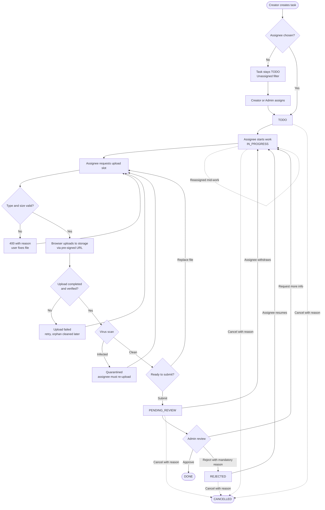
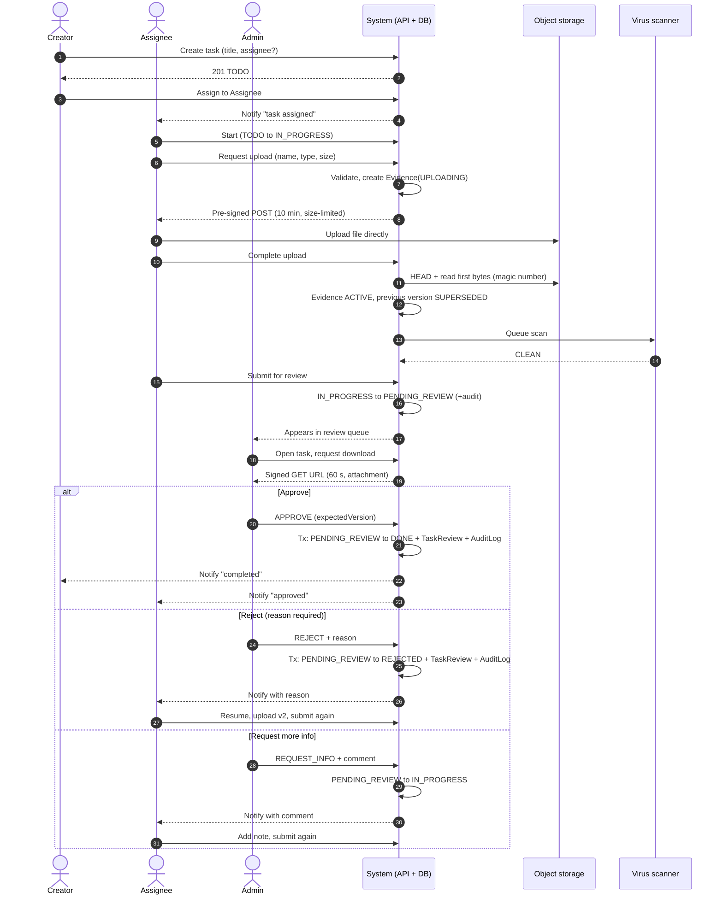
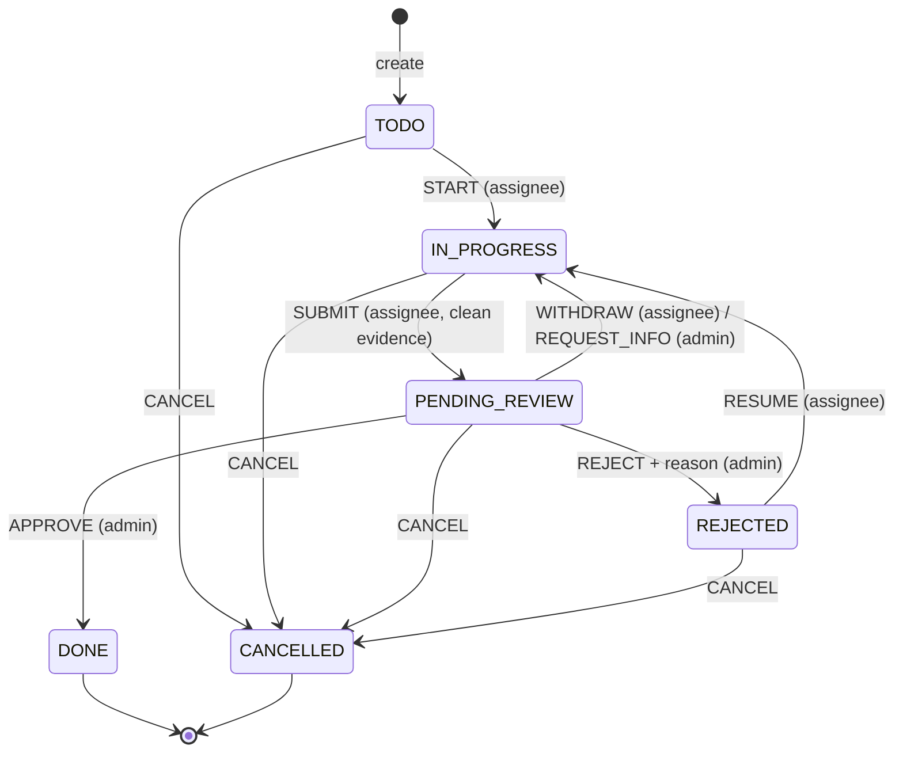
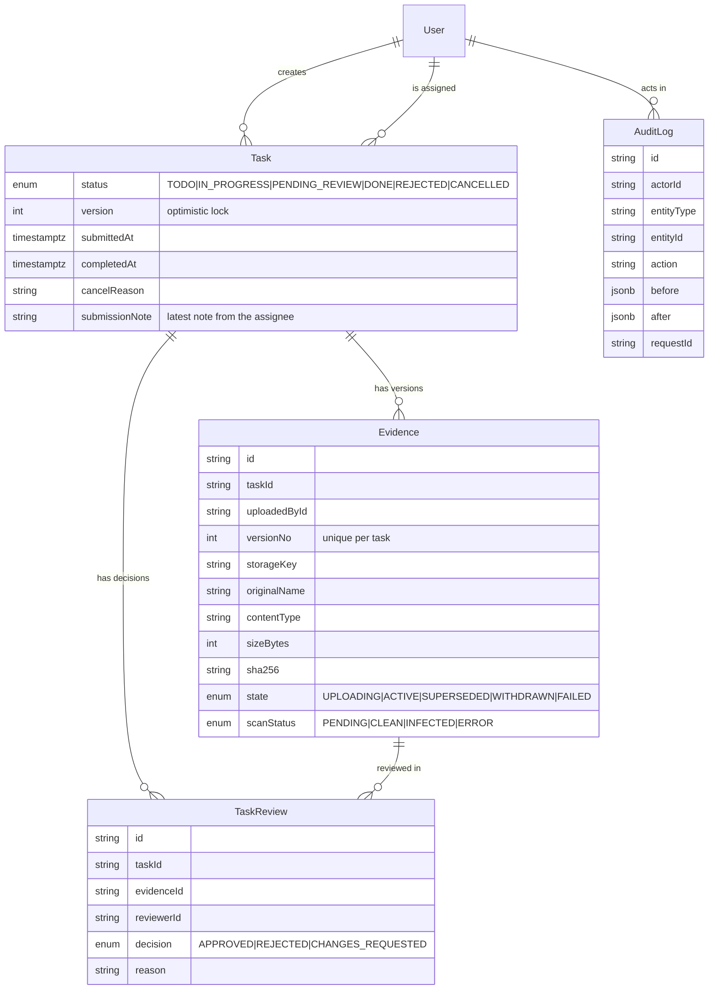
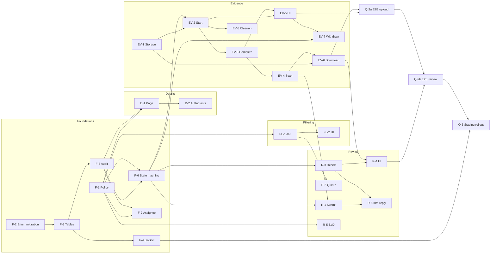
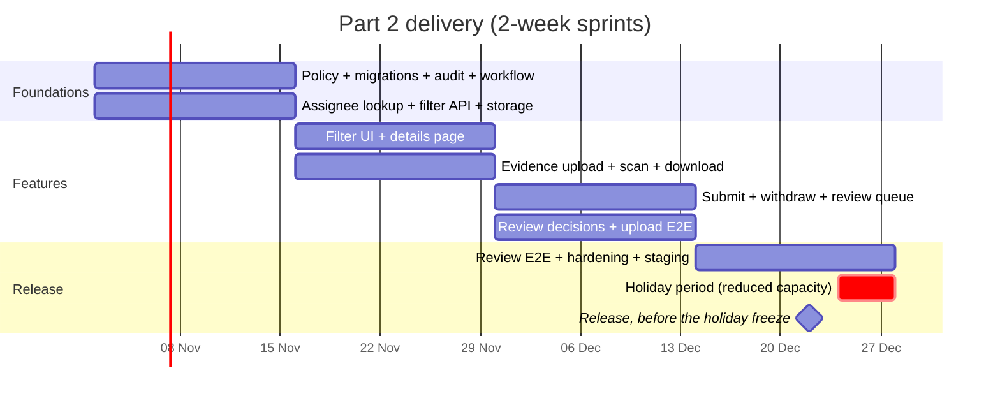

# Overview

Part 2 adds four things to the portal:

1. Users can filter tasks by status and by assignee.
2. Each task gets its own details screen.
3. The person assigned to a task uploads a document as evidence that the work is done.
4. An admin reviews that evidence and approves the task as complete.

A few principles shaped the design.

- The server owns the workflow. Every status change goes through a single state machine in the service layer, driven by a transition table. Clients never send a new status directly. They ask for an action such as `SUBMIT` or `APPROVE`, and the server decides whether it is allowed.
- There is one authorization policy. A pure function, `can(actor, action, task)`, answers every permission question. Pages, API handlers and the transition service all use it, and it has exhaustive unit tests.
- Files don't go through our app server. The browser uploads straight to S3-compatible object storage using short-lived pre-signed URLs. Postgres only keeps the metadata, the version history and the scan results.
- Everything can be audited. Every transition, upload and review decision writes an `AuditLog` row in the same database transaction as the change itself.
- It builds on Part 1. We already have `role`, `assigneeId` and an index on `(assigneeId, status)`. Ownership scoping already lives in one repository function, and Part 2 just widens it.

**Scope at a glance.** The full plan is 96 points over four sprints, but not all of it is needed to meet the four requirements. If the business needs the feature sooner, the **minimum release is 83 points (about three sprints)**. It covers filtering, the details page, evidence upload with virus scanning, admin review, and the tests and staging rehearsal needed to release safely. Virus scanning stays in the minimum release because evidence files are downloaded by other people. The remaining 13 points can follow in the next release without blocking anyone:

- Withdrawing a submission (EV-7). Until it ships, an assignee who submitted the wrong file asks the admin to use _Request more info_.
- Cleaning up abandoned uploads (EV-8). Orphaned files cost storage but don't affect users.
- Replying to _Request more info_ with a note (R-6). Until it ships, the assignee just resubmits.
- The activity timeline, observability dashboards and full documentation (Q-1, Q-3, Q-4). The audit rows are still written from day one, so the timeline can be built from existing data later.

Notifications (N-1) are a stretch goal in either case. Section B.2 marks which stories are deferrable.

# A. Process flow map

## A.1 Happy path

1. **Created.** A user (the creator) creates a task. It starts in `TODO`. Choosing an assignee at this point is optional.
2. **Assigned.** The creator or an admin picks an assignee from the user lookup. Ideally the assignee is notified, but notifications are a stretch goal.
3. **In progress.** The assignee starts work, which moves the task from `TODO` to `IN_PROGRESS`.
4. **Evidence uploaded.** The assignee asks for an upload slot. The API checks the declared file type and size, creates an `Evidence` row in the `UPLOADING` state, and returns a pre-signed POST. The browser then uploads the file directly to object storage and calls _complete_. At that point the server checks the stored object's size, magic bytes and checksum, marks the evidence `ACTIVE`, and queues a virus scan.
5. **Submitted for review.** Once the latest evidence has come back `CLEAN`, the assignee submits the task. It moves from `IN_PROGRESS` to `PENDING_REVIEW` and shows up in the admin review queue.
6. **Admin review.** An admin who isn't the assignee opens the task, downloads the evidence through a short-lived signed URL, and makes a decision.
7. **Approved and completed.** Approval moves the task from `PENDING_REVIEW` to `DONE`. The same transaction writes a `TaskReview` row and an `AuditLog` row. The creator and assignee are notified.

## A.2 Flowchart with alternative paths

The table below describes what happens when things don't go to plan.

| Scenario | Who triggers it | What happens | Resulting status |
| --- | --- | --- | --- |
| **Admin rejects** | An admin, who must give a reason of at least 10 characters | We write a `TaskReview(REJECTED, reason)` row. The evidence is kept as history, and the assignee can read the reason on the details page. | `REJECTED`, then `IN_PROGRESS` once the assignee resumes. Uploading a new file resumes the task automatically. |
| **Resubmit after rejection** | The assignee | They upload a new version (`v n+1`), which marks the previous one `SUPERSEDED`, and submit again. | `PENDING_REVIEW` |
| **Admin asks for more info** | An admin, who must leave a comment | We write `TaskReview(CHANGES_REQUESTED)`. Unlike a rejection, the current evidence stays `ACTIVE`, so the assignee can reply with a note (saved as `submissionNote`) and resubmit without uploading a new file. | `IN_PROGRESS` |
| **Reassigned mid-work** | The creator or an admin, while the task is `TODO`, `IN_PROGRESS` or `REJECTED` | `assigneeId` changes. Any existing evidence is kept but flagged as coming from the previous assignee, and the new assignee has to upload their own before they can submit. Both people are notified. Reassignment isn't allowed during `PENDING_REVIEW`; the task has to be withdrawn first. | Unchanged |
| **Upload fails or the file is invalid** | The system | If the declared type or size is wrong, we reject it straight away with a 400. If the stored object doesn't match on _complete_ (wrong magic bytes, size or checksum), we delete the object, mark the evidence `FAILED` and return a 422. Network failures can simply be retried. A cleanup job and an S3 lifecycle rule remove unfinished `UPLOADING` rows older than 24 hours. | Unchanged |
| **Withdraw or replace evidence before review** | The assignee | While the task is `IN_PROGRESS`, uploading again replaces the active version. While it's `PENDING_REVIEW`, the assignee can _Withdraw_ it back to `IN_PROGRESS`, but only until an admin records a decision. There's no separate "claim" step. If an admin decides at the same moment the assignee withdraws, the version check lets only one of them succeed, and the other gets a 409. | `IN_PROGRESS` |
| **Task cancelled** | The creator or an admin, who must give a reason | This works from any non-terminal state. Evidence is kept according to the retention policy, and any open review is closed. | `CANCELLED` (terminal) |
| **Unassigned task** | — | `assigneeId` is null, so nobody can start the task. The "Start" button is hidden and the API returns 409 if called anyway. The task appears under the _Unassigned_ filter. | `TODO` |
| **Virus scan finds malware** | The system | We move the object to a quarantine prefix and set the evidence to `scanStatus = INFECTED`. Submitting stays blocked, and the security channel gets an alert. | Unchanged |
| **Two admins review at the same time** | Admins | Whoever commits first wins, thanks to a version check. The second admin gets a 409 and a refreshed view. | Whatever the first decision was |

## A.3 Swimlane view by actor

This diagram shows the same flow from the point of view of each person and system involved.

## A.4 Status state machine

The table below lists every allowed transition and who can perform it. These rules are enforced in `task-workflow.service.ts` and in the `can()` policy.

| # | From → To | Action | Who can do it | Conditions and side effects |
| --- | --- | --- | --- | --- |
| 1 | — → `TODO` | `CREATE` | Any signed-in user | We record the creator. An assignee is optional. |
| 2 | `TODO` → `IN_PROGRESS` | `START` | The current assignee | `assigneeId` has to be set. |
| 3 | `IN_PROGRESS` → `PENDING_REVIEW` | `SUBMIT` | The current assignee | The latest evidence must be `ACTIVE`, `CLEAN` and uploaded by the current assignee. Sets `submittedAt`. An optional note is saved to `submissionNote`. |
| 4 | `PENDING_REVIEW` → `IN_PROGRESS` | `WITHDRAW` | The current assignee | Only if no review decision has been made yet. `expectedVersion` must match, so it can't race an admin's decision. |
| 5 | `PENDING_REVIEW` → `IN_PROGRESS` | `REQUEST_INFO` | An admin | A comment is required. Writes `TaskReview(CHANGES_REQUESTED)`. |
| 6 | `PENDING_REVIEW` → `DONE` | `APPROVE` | An admin who is **not** the assignee | `expectedVersion` must match. Sets `completedAt` and writes `TaskReview(APPROVED)`. |
| 7 | `PENDING_REVIEW` → `REJECTED` | `REJECT` | An admin who is **not** the assignee | The reason must be at least 10 characters. Writes `TaskReview(REJECTED)`. |
| 8 | `REJECTED` → `IN_PROGRESS` | `RESUME` | The current assignee | Happens automatically when a new version is uploaded. |
| 9 | Any non-terminal state → `CANCELLED` | `CANCEL` | The creator or an admin | A reason is required. This is terminal. |
| — | (field change) | `REASSIGN` | The creator or an admin | The status must be `TODO`, `IN_PROGRESS` or `REJECTED`, and the new assignee must be an active user. |

`DONE` and `CANCELLED` are terminal states. Re-opening a task is out of scope for now. If we need it later, it would be an admin-only `REOPEN` transition. The inline status dropdown from Part 1 still works, but it now only offers the actions the current user is allowed to take, so nobody can jump straight to `DONE` anymore.

**Who can see a task:** its creator, its current assignee and any admin. Everyone else gets a **404**, the same as in Part 1. If someone can see a task but tries an action they aren't allowed to do, they get a **403**. If the action isn't a valid transition from the current status, they get a **409**.

## A.5 Data model changes

**How we migrate the live Postgres database**

1. **Migration 1 adds the enum values and nothing else.** It runs `ALTER TYPE "TaskStatus" ADD VALUE 'PENDING_REVIEW'`, plus the same for `REJECTED` and `CANCELLED`. Postgres won't let you use a new enum value in the same transaction that adds it, so this has to be its own migration. Adding enum values doesn't rewrite the table.
2. **Migration 2 adds the new tables and columns.** That means the `evidence`, `task_reviews` and `audit_logs` tables, and on `tasks` the columns `version INT NOT NULL DEFAULT 0`, `submittedAt`, `completedAt`, `cancelReason` and `submissionNote`. Everything is additive and either nullable or has a default, so nothing holds a long lock. New indexes are created `CONCURRENTLY` in a hand-edited migration.
3. **Migration 3 backfills the data.** Existing tasks keep their current status. Tasks that are already `DONE` are grandfathered in as completed without a review, and we record that with an `AuditLog(action = 'MIGRATED_DONE')` row. Tasks with `assigneeId IS NULL` simply stay unassigned. The backfill runs in batches and is safe to run more than once.
4. **We expand first and contract later.** The new code is released able to handle both the old and new shapes. The old status-only endpoints are removed one release later.

## A.6 New API endpoints

| Method and path | What it does |
| --- | --- |
| `GET /api/tasks?status=…&assignee=me\|unassigned\|<id>&cursor=` | Returns the filtered task list with cursor pagination. The query is validated with Zod. |
| `GET /api/users?query=` | Looks up users who can be assigned. Returns only `id` and `name`, needs at least 2 characters, and is rate-limited. |
| `GET /api/tasks/:id` | Returns task details, including evidence versions, reviews and the activity timeline. |
| `PATCH /api/tasks/:id/assignee` | Reassigns the task (creator or admin). |
| `POST /api/tasks/:id/transitions` | Takes `{ action, reason?, note?, expectedVersion }` and passes it to the state machine. `note` is only used by `SUBMIT`. |
| `POST /api/tasks/:id/evidence` | Starts an upload and returns `{ evidenceId, url, fields }`, which is a pre-signed POST. |
| `POST /api/tasks/:id/evidence/:eid/complete` | Checks the stored object, activates the version and queues the scan. |
| `GET /api/tasks/:id/evidence/:eid/download` | Redirects (302) to a signed GET URL that lasts 60 s and uses `Content-Disposition: attachment`. |
| `GET /api/admin/reviews?cursor=` | The review queue: tasks in `PENDING_REVIEW`, oldest first. |
| `POST /api/admin/reviews/:taskId` | Takes `{ decision, reason, expectedVersion }`. |

# B. Sprint implementation plan

## B.1 Assumptions

These are planning assumptions, not known facts. They should be confirmed with the team and the product owner before Sprint 1, and the sprint allocation in B.4 adjusted to match.

- **Team and cadence (assumed).** 2-week sprints, with 3 developers (2 full-stack and 1 who leans backend) and 1 QA. The tech lead does reviews and architecture and is hands-on about half the time.
- **Velocity (assumed).** About 30 story points per sprint, which is an estimate for a team of this size after a 20% buffer for reviews and meetings. We use Fibonacci points, and 1 point is roughly half a developer-day. After Sprint 1 we replace this estimate with the team's measured velocity.
- **Evidence rules.**
  - One evidence file per submission. A new upload creates a new version, and we keep every version. History is never deleted.
  - Files can be at most 10 MB.
  - Allowed types are PDF, PNG, JPG and DOCX. The declared MIME type has to agree with the file's magic bytes.
- **Storage.** We use S3-compatible object storage with pre-signed URLs: AWS S3 in production and MinIO in `docker-compose` for local development. The bucket is private, encrypted (SSE-S3 or KMS) and blocks public access. Metadata lives in Postgres.
- **Admins.** Admins are either seeded or promoted with a database script or an admin CLI. A UI for managing roles is out of scope.
- **Virus scanning.** ClamAV runs as a container worker, triggered from a job queue. We'll use a Postgres-backed queue such as `pg-boss` so we don't add another piece of infrastructure. It can be swapped for a managed scanner later.
- **Notifications.** These are a stretch goal. In-app notifications come first, then email through a transactional provider, using an outbox table.

## B.2 Epics and stories

Estimates are in story points. The acceptance criteria (AC) are written in Given / When / Then form. Stories marked _(deferrable)_ are outside the minimum release described in the overview.

### Epic 1: Foundations (RBAC, schema, workflow core)

| ID | Title | Description | Est | Depends on | Acceptance criteria |
| --- | --- | --- | --- | --- | --- |
| F-1 | Authorization policy module | A pure `can(actor, action, task)` function that covers view, edit, assign, start, upload, submit, withdraw, review and cancel, plus `requireRole('ADMIN')`. It comes with table-driven unit tests for every combination of role, status and action. | 3 | — | **Given** a user who isn't the creator, the assignee or an admin, **when** they request `GET /api/tasks/:id`, **then** they get a 404. **Given** an assignee, **when** `can(assignee, 'REVIEW', task)` is called, **then** it returns false. |
| F-2 | Schema migration: enum values | A separate migration that adds `PENDING_REVIEW`, `REJECTED` and `CANCELLED` using `ALTER TYPE … ADD VALUE`. | 2 | — | **Given** a database on the Part 1 schema, **when** `prisma migrate deploy` runs, **then** the enum has 6 values and no table is rewritten. We check this against a production-sized snapshot. |
| F-3 | Schema migration: tables and columns | Adds `Evidence`, `TaskReview` and `AuditLog`, plus `Task.version`, `submittedAt`, `completedAt`, `cancelReason` and `submissionNote`, and the indexes (created concurrently where needed). | 5 | F-2 | **Given** the migrated database, **when** I insert evidence with a duplicate `(taskId, versionNo)`, **then** the unique constraint rejects it. Deleting a task that has evidence is also blocked. |
| F-4 | Data backfill | A batch script that can safely run more than once. It grandfathers `DONE` tasks with an audit entry and checks the counts. We rehearse it on staging. | 3 | F-3 | **Given** existing `DONE` tasks, **when** the backfill runs twice, **then** each one has exactly one `MIGRATED_DONE` audit row and its status hasn't changed. |
| F-5 | Audit log service | `audit.record(tx, {...})`, called inside the same transaction as each change. It records the request ID and the actor. | 3 | F-3 | **Given** any state transition, **when** the transaction commits, **then** exactly one matching `AuditLog` row exists. **When** it rolls back, **then** there is none. |
| F-6 | Workflow state machine | A transition service driven by the A.4 table, with guard functions and an optimistic `version` check. It replaces the current free-form status updates. | 5 | F-1, F-5 | **Given** a task in `TODO`, **when** someone requests `SUBMIT`, **then** the API returns 409 `INVALID_TRANSITION` and the status doesn't change. |
| F-7 | Assignee lookup and reassignment | `GET /api/users?query=` (returns id and name only, rate-limited), an accessible combobox, and `PATCH /assignee` following the rules in A.2. | 5 | F-1, F-5 | **Given** a task in `PENDING_REVIEW`, **when** the creator tries to reassign it, **then** they get a 409 saying "withdraw first". **Given** a 1-character search, **then** they get a 400. |

### Epic 2: Filtering

| ID | Title | Description | Est | Depends on | Acceptance criteria |
| --- | --- | --- | --- | --- | --- |
| FL-1 | Filtered list API | Zod-validated filters for `status` (multiple allowed) and `assignee` (`me`, `unassigned` or a user id), plus a cursor. The visibility scope is applied first, and the query uses the `(assigneeId, status)` index. | 3 | F-1 | **Given** 10k seeded tasks, **when** I filter by `assignee=me&status=IN_PROGRESS`, **then** `EXPLAIN` shows an index scan on `tasks_assigneeId_status_idx` and p95 is under 50 ms. |
| FL-2 | Filter UI synced to the URL | A filter bar that updates `searchParams`, with results rendered on the server. URLs can be shared, there's a "Clear filters" action, and empty states are handled. | 3 | FL-1 | **Given** I've filtered by status=Done, **when** I reload the page or share the URL, **then** the same filtered list appears. The controls are also labelled and work with the keyboard. |

### Epic 3: Task details

| ID | Title | Description | Est | Depends on | Acceptance criteria |
| --- | --- | --- | --- | --- | --- |
| D-1 | `/tasks/[id]` details page | A server component that shows the task's fields, assignee, status, the actions available to the viewer (from `can()`), evidence versions, review history and an activity timeline built from the audit log. It has `loading`, `not-found` and `error` states. | 5 | F-1, F-5 | **Given** I'm the assignee, **when** I open the page, **then** I see Upload and Submit but not Approve. **Given** I have nothing to do with the task, **then** I see the 404 page and the response really is a 404. |
| D-2 | Authorization tests for details | Integration tests that run the creator, assignee, admin and an outsider against every endpoint under `/api/tasks/:id/**`. | 2 | D-1 | **Given** the role matrix, **when** the suite runs, **then** every cell gets the expected 200, 403 or 404. |

### Epic 4: Evidence upload

| ID | Title | Description | Est | Depends on | Acceptance criteria |
| --- | --- | --- | --- | --- | --- |
| EV-1 | Storage abstraction | An `ObjectStorage` interface (`presignPost`, `head`, `readRange`, `move`, `presignGet`, `delete`) with an S3 implementation, MinIO in compose, and an in-memory fake for tests. | 3 | — | **Given** the fake adapter, **when** the service tests run, **then** they make no network calls. The S3 adapter also passes a contract test against MinIO in CI. |
| EV-2 | Start upload | `POST /evidence`, allowed only for the assignee and only in `IN_PROGRESS` or `REJECTED`. It checks the declared type and size (10 MB at most), creates `Evidence(UPLOADING)`, and returns a pre-signed POST with a `content-length-range`, a fixed `Content-Type` and a 10-minute expiry. Object keys are random (`evidence/{taskId}/{uuid}`) and never include the original filename. | 5 | EV-1, F-6 | **Given** a 12 MB file, **when** the upload starts, **then** the API returns 400 `FILE_TOO_LARGE`. **Given** the creator, who isn't the assignee, **then** they get a 403. **Given** the status is `PENDING_REVIEW`, **then** they get a 409. |
| EV-3 | Complete and verify upload | A `HEAD` request checks the size, we read the magic bytes to confirm the type, and we record the SHA-256. In one transaction the new version is activated and the previous one superseded. If anything doesn't match, the evidence is marked `FAILED` and the object is deleted. | 3 | EV-2 | **Given** a `.pdf` file that is actually a PNG, **when** the upload completes, **then** the API returns 422 and the evidence is `FAILED`. **Given** a valid file, **then** `versionNo` goes up by one and the earlier version becomes `SUPERSEDED`. |
| EV-4 | Virus-scan hook | A job queue and a ClamAV worker. `scanStatus` moves from `PENDING` to `CLEAN`, `INFECTED` or `ERROR`. Infected files are moved to `quarantine/` and trigger an alert. Submitting is blocked until the file is `CLEAN`. | 5 | EV-3 | **Given** the EICAR test file, **when** it's scanned, **then** its status is `INFECTED`, the object is quarantined and submitting returns a 409. **Given** the scanner is down, **then** the status stays `PENDING` and the job retries with backoff. |
| EV-5 | Upload UI | Drag-and-drop or a file picker, a client-side type and size check, a progress bar, a retry button, a scan-status badge and a version list. Screen readers get updates through `aria-live`. | 5 | EV-2, EV-3 | **Given** the network drops mid-upload, **when** I click Retry, **then** a fresh pre-signed URL is used and the upload succeeds. Progress is also announced to screen readers. |
| EV-6 | Secure download | An authorized `GET …/download` that redirects (302) to a signed URL lasting 60 seconds with `attachment` disposition. Only files with `scanStatus = CLEAN` are served, so a file that is infected, failed or not yet scanned can never be downloaded. | 2 | EV-1, F-1, EV-4 | **Given** an outsider, **when** they request a download, **then** they get a 404. **Given** an admin, **then** the signed URL stops working after 60 s. **Given** evidence still `PENDING` scan, **then** the download returns a 409. |
| EV-7 | Withdraw and replace before review _(deferrable)_ | The `WITHDRAW` transition and a "Replace file" flow in the UI. | 2 | F-6, EV-5 | **Given** a task in `PENDING_REVIEW` with no decision yet, **when** the assignee withdraws it, **then** the status is `IN_PROGRESS` and the evidence is still listed. |
| EV-8 | Orphan cleanup _(deferrable)_ | A scheduled job that removes `UPLOADING` rows older than 24 hours, plus an S3 lifecycle rule for keys nothing refers to. | 2 | EV-2 | **Given** an upload abandoned more than 24 hours ago, **when** the job runs, **then** the row is `FAILED` and the object has been deleted. |

### Epic 5: Admin review

| ID | Title | Description | Est | Depends on | Acceptance criteria |
| --- | --- | --- | --- | --- | --- |
| R-1 | Submit for review | The `SUBMIT` transition with a check on the evidence, and a button in the UI that asks for confirmation. | 2 | F-6, EV-4 | **Given** the latest evidence is still waiting for its scan (`PENDING`), **when** the assignee submits, **then** they get a 409 saying "Evidence is still being scanned". |
| R-2 | Review queue | `/admin/reviews`, for admins only. It lists the oldest tasks first, shows how long each has waited and who the assignee is, and is paginated. | 3 | F-1, FL-1 | **Given** a non-admin, **when** they open `/admin/reviews`, **then** they get a 404. **Given** 3 tasks waiting for review, **then** they're listed oldest first. |
| R-3 | Review decision endpoint | Approve, reject or request info inside one database transaction: `UPDATE … WHERE id=$1 AND status='PENDING_REVIEW' AND version=$2`, then insert the `TaskReview` and `AuditLog` rows. | 5 | F-5, F-6 | **Given** two admins approve and reject at the same moment, **when** both submit, **then** only one succeeds, the other gets 409 `STALE_VERSION`, and there is one `TaskReview` row. **Given** a rejection with no reason, **then** the admin gets a 400. |
| R-4 | Review UI | An evidence preview (images shown inline, other files downloaded), a decision form where the reason is mandatory, and a banner with a refresh button when there's a conflict. | 3 | R-3, EV-6 | **Given** I choose Reject, **when** the reason is empty, **then** the submit button stays disabled and an inline error is announced. |
| R-5 | Segregation of duties | Admins can't review tasks assigned to themselves. This is enforced in `can()`. | 1 | F-1 | **Given** an admin who is also the assignee, **when** they try to approve, **then** they get a 403. |
| R-6 | Reply to a request for more info _(deferrable)_ | A note field on the submit dialog, saved to `submissionNote` and recorded in the audit log. Reviewers see the latest note next to the evidence, and earlier notes appear in the activity timeline. | 2 | R-1, R-3 | **Given** an admin has requested more info, **when** the assignee adds a note and submits without uploading a new file, **then** the task is `PENDING_REVIEW` and the reviewer sees the note. |

### Epic 6: Notifications, audit, quality and release

| ID | Title | Description | Est | Depends on | Acceptance criteria |
| --- | --- | --- | --- | --- | --- |
| N-1 | Notifications _(stretch)_ | An outbox table written in the same transaction as the transition. A worker sends in-app and email messages when a task is assigned, submitted, rejected or approved. | 5 | F-5 | **Given** a rejection, **when** the transaction commits, **then** the assignee receives exactly one message, even if the worker restarts. |
| Q-1 | Activity timeline _(deferrable)_ | A timeline on the details page, built from the `AuditLog`, showing who did what and when. | 2 | D-1, F-5 | **Given** a task that was rejected and then approved, **then** the timeline shows every step with the person and the time. |
| Q-2a | End-to-end tests: upload and access | Playwright tests for uploading evidence, an invalid file and access by an outsider. These only need the Sprint 2 features, so they're written early in Sprint 3. | 2 | EV-5, EV-6 | **Given** CI running Postgres, MinIO and a ClamAV stub, **when** the e2e job runs, **then** every upload and access scenario passes. |
| Q-2b | End-to-end tests: review flows | Playwright tests for the full happy path, the rejection loop, the request-info loop and a concurrent review (using two browser contexts). QA drafts them in Sprint 3 as R-4 lands and finishes them at the start of Sprint 4. | 3 | R-4, Q-2a | **Given** the same CI setup, **when** the e2e job runs, **then** every review scenario passes. The feature flag stays off until they do. |
| Q-3 | Observability _(deferrable)_ | Structured logs with a request ID. Metrics for upload failures, scan latency, review lead time and the rate of 409s. Alerts for scan errors and infected files. | 3 | EV-4, R-3 | **Given** an infected upload, **then** an alert fires within 5 minutes. Dashboards also show the review backlog by age. |
| Q-4 | Documentation _(deferrable)_ | README, API reference, a runbook for rolling back migrations and for scanner outages, and ADRs for the storage choice and the state machine. | 2 | — | **Given** a new developer, **when** they follow the README, **then** they can run the full flow locally with MinIO in under 30 minutes. |
| Q-5 | Staging rollout | Rehearse the migrations on a staging copy of production data, put the review workflow behind a feature flag, and roll it out in stages. | 2 | F-4, Q-2b | **Given** staging, **when** the migrations run, **then** no lock lasts longer than 1 s and the flag can be turned off without losing data. |

That adds up to 96 points, plus 5 for the stretch story (N-1). At our velocity that's about 3 sprints of feature work followed by a hardening sprint.

## B.3 Dependency graph

The schema chain F-2 → F-3 → F-5 → F-6 comes first. After F-6 the work splits into two long chains:

- Evidence: F-6 → EV-2 → EV-3 → EV-4 → R-1 → R-6
- Review and release: F-6 → R-3 → R-4 → Q-2b → Q-5

F-1 (policy) also feeds F-6, and almost every later story depends on it. It's 3 points against the 10 points of F-2 → F-3 → F-5, so it has some slack and isn't strictly on the critical path. It still needs to be finished early in Sprint 1, because if it slips it becomes the critical path. EV-1 (storage) doesn't depend on anything, so we can start it on day 1 alongside the schema work.

## B.4 Sprint allocation

| Sprint | Goal | Stories | Points |
| --- | --- | --- | --- |
| **Sprint 1** | _"The workflow exists, safely."_ The schema is migrated on staging, the policy and state machine are in place, and filtering works through the API. | F-1, F-2, F-3, F-4, F-5, F-6, F-7, FL-1, EV-1 | 32 |
| **Sprint 2** | _"Assignees can upload evidence."_ The filter UI, the details page, and the full evidence pipeline including virus scanning, so nothing can be downloaded before it has been scanned. | FL-2, D-1, D-2, EV-2, EV-3, EV-4, EV-5, EV-6 | 30 |
| **Sprint 3** | _"Admins can approve."_ Submission, withdrawal, the review queue and review decisions, replying to info requests, and the first end-to-end tests. | EV-7, EV-8, R-1, R-2, R-3, R-4, R-5, R-6, Q-1, Q-2a | 24 |
| **Sprint 4** (hardening) | _"Ship it."_ Review end-to-end tests, observability, documentation, the staging rehearsal, a release behind a feature flag, and time for fixing defects. | Q-2b, Q-3, Q-4, Q-5, N-1 (stretch) | 10 + 5 stretch |

Sprint 1 is a little over our velocity (32 points against roughly 30). If it starts slipping, F-7 (assignee lookup) can move to Sprint 2, because nothing else depends on it.

Virus scanning (EV-4) ships in Sprint 2 together with downloads (EV-6), and EV-6 only serves files that have been scanned clean. That way there's never a sprint where an unscanned file can be downloaded, even on staging. Sprint 2 is a full sprint as a result. The EV-2 → EV-3 → EV-4 chain is sequential, so the ClamAV worker is built against the in-memory storage fake in parallel with EV-2 and EV-3, and only wired in at the end.

The review end-to-end tests (Q-2b) are deliberately not squeezed into the end of Sprint 3, where they would depend on R-4 finishing in the same sprint. Instead, Sprint 3 covers the upload and access tests (Q-2a), which only need Sprint 2 features. QA drafts the review scenarios while R-4 is being built, and they're finished at the start of Sprint 4. The feature flag stays off until they pass, so the Definition of Done is still met before anyone uses the review flow.

Sprint 4 runs from 14 to 27 December, which includes the Christmas holidays. We plan for about half our usual capacity in that sprint (around 15 points). That still covers the 10 committed points. N-1 is the first thing to drop. We aim to release by 22 December and freeze changes over the holidays, so the release isn't happening while people are away. The spare capacity goes to defects found in QA and UAT and to performance work. QA writes test cases from these acceptance criteria in the same sprint the story is built, not afterwards.

## B.5 Risks and mitigations

| Risk | Likelihood / Impact | How we handle it |
| --- | --- | --- |
| **Malicious or disguised files**, such as malware, polyglot files, or XSS through SVG or HTML | Medium / High | We only accept 4 file types, and we check the magic bytes rather than trusting the declared type. SVG and HTML are never accepted. ClamAV scans every file before any reviewer can download it. Files are only served as `attachment` from the storage domain, never inline from the app's own origin. Object keys are random, and the bucket is private and encrypted. |
| **Large or slow uploads** that tie up servers or time out | Medium / Medium | Files go straight to S3 with a pre-signed POST, so the app server never handles the bytes. S3 enforces `content-length-range`, and there's a 10 MB cap. Retries use fresh URLs, and orphans are cleaned up (EV-8). If we raise the cap later, we can add multipart upload. |
| **Concurrent reviews**, for example two admins at once, or an admin deciding while the assignee withdraws | Medium / High | A conditional `UPDATE … WHERE status AND version` inside one transaction. The loser gets 409 `STALE_VERSION` and the UI refreshes. An integration test and a two-context E2E test cover this. |
| **Enum and data migration on live Postgres** | Medium / High | Enum values go in their own migration, which avoids a table rewrite. New columns are additive with defaults. Indexes use `CREATE INDEX CONCURRENTLY`. The backfill runs in batches and is safe to repeat. We rehearse on a staging snapshot with `lock_timeout` set, release in expand-then-contract steps, and take a backup right before the release. |
| **Part 1 behaviour changes**, because users can no longer set `DONE` themselves | High / Low | We explain it in release notes and in the app. The status dropdown only shows allowed actions, and existing `DONE` tasks are grandfathered. |
| **A scanner outage blocks submissions** | Low / Medium | The status stays `PENDING` and the queue retries with backoff. An alert fires and there's a runbook. If it turns out to be needed, we can add a manual admin override later, and that override would itself be audited. |
| **Permission bugs (IDOR) in new endpoints** | Medium / High | One `can()` policy, the visibility scope applied in the repository, a test matrix of roles against endpoints (D-2), and a security review as part of the Definition of Done. |
| **The holidays shrink Sprint 4** and the release slips into the new year | Medium / Medium | We plan Sprint 4 at about half capacity and commit only 10 points. The release target is 22 December, before the holiday freeze. If that date is missed, the flag stays off and we release in the first week of January rather than over the holidays. |
| **Scope creep** into notifications, re-opening or comments | Medium / Medium | N-1 is marked as a stretch goal. Re-opening and comments are explicitly out of scope and go to the backlog. |

## B.6 Definition of Done

A story counts as done when all of these are true:

- [ ] The acceptance criteria pass and have been shown to the PO and QA.
- [ ] Unit and integration tests have been added, including negative and authorization cases, and CI is green (lint, typecheck, tests and build).
- [ ] E2E tests have been updated if a user journey changed.
- [ ] The code has been peer-reviewed against the security checklist. One approval is enough, except for changes to auth, storage or migrations, which need two.
- [ ] Accessibility has been checked: keyboard navigation, labels, focus management, `aria-live` for async states, and an axe scan with no serious issues.
- [ ] Migrations can be reversed or have a documented roll-forward, and any migration that touches existing data has been rehearsed on staging.
- [ ] State changes emit audit events, and logs and metrics have been added.
- [ ] Docs have been updated (README, API reference, and an ADR if a decision changed).
- [ ] It's deployed to staging behind the feature flag and QA has smoke-tested it.

## B.7 Non-functional requirements

- **Security**
  - Least privilege, enforced in one policy module.
  - A 404 for anything the user can't see, and a 403 for forbidden actions on things they can see.
  - Pre-signed URLs are short-lived and limited in size.
  - Data is encrypted in transit and at rest.
  - Object keys never contain the original filename, and filenames are sanitised in `Content-Disposition`.
  - Upload endpoints are rate-limited.
  - Separation of duties: nobody can approve their own work.
  - The existing CSRF Origin check and `SameSite` cookies cover all the new write operations.
- **Audit trail**
  - `AuditLog` is append-only. The application's database role has no `UPDATE` or `DELETE` grant on it.
  - Each entry records the actor, the action, the before and after values (never file contents), the request ID and a timestamp, and it's written in the same transaction as the change.
  - Entries are kept for at least 1 year.
  - Evidence versions are never hard-deleted while the task still exists.
- **Observability**
  - Logs are structured JSON with a request ID, which is passed through to background jobs.
  - We track upload successes and failures (by reason), scan latency, review lead time (from submission to decision), queue depth by age, and the rate of 409 conflicts.
  - We alert on infected files, scanner errors, and review backlogs older than the SLA (for example, 2 business days).
- **Performance**
  - List and filter queries use the `(assigneeId, status)` and `createdById` indexes with cursor pagination, never `OFFSET`.
  - The targets are a p95 under 200 ms for the list and details pages, and under 300 ms for starting an upload.
  - File bytes never pass through the app.
  - The details page loads evidence and review history with a bounded number of queries, so there's no N+1 problem.
- **Accessibility.** New screens meet WCAG 2.2 AA, including the upload control, the review form and the filter bar.
- **Privacy and retention.** Evidence follows the retention policy, for example 7 years for compliance evidence. Purging it is an admin-only operation and is audited.
